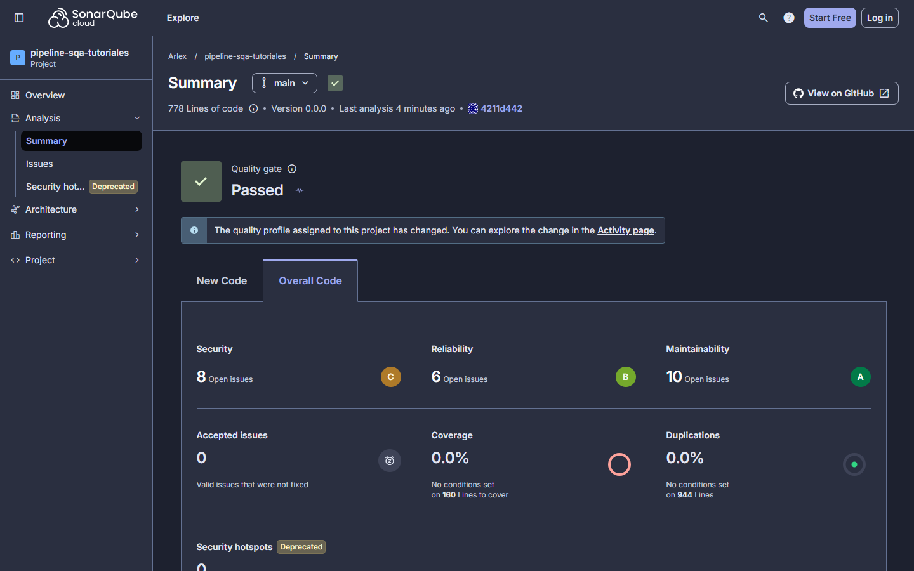
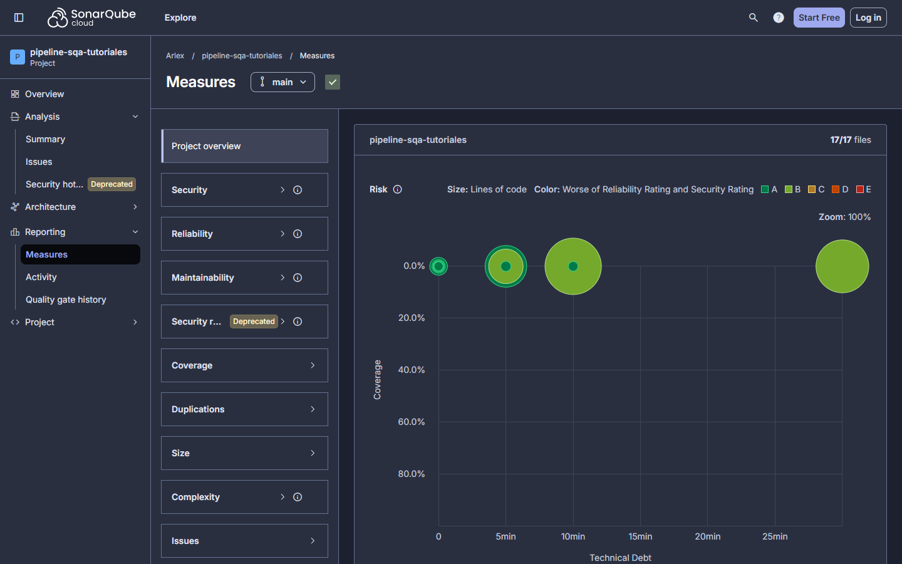
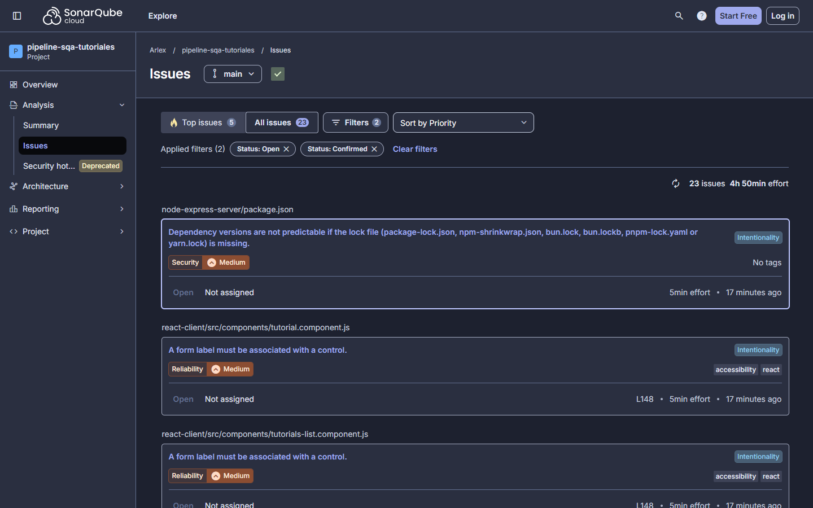

# Línea base de calidad

Métricas del código original, antes de cualquier intervención. Es el "antes" contra el que se compara el estado final en [Reporte-Mejora.md](Reporte-Mejora.md).

| Dato              | Valor                                                                                                          |
| ----------------- | -------------------------------------------------------------------------------------------------------------- |
| Estado medido     | Etiqueta `v0-linea-base`, commit `4211d44`                                                                     |
| Origen del código | [bezkoder/react-express-mysql](https://github.com/bezkoder/react-express-mysql), commit `570e477`, sin cambios |
| Fecha de medición | 5 de noviembre de 2026                                                                                         |
| Entorno           | Windows 11, Node.js 24.14.1, npm 11.11.0, Docker 29.9.2                                                        |
| Evidencia         | [docs/evidencia/linea-base/](evidencia/linea-base/)                                                            |
| Capturas          | [docs/img/linea-base/](img/linea-base/)                                                                        |

El árbol de archivos del commit `4211d44` es idéntico al del commit original `570e477`. Tiene 34 archivos, y ninguno de los de texto trae finales de línea CRLF.

## 1. Resumen

| Métrica                                  | Servidor                   | Cliente                              | Proyecto                         |
| ---------------------------------------- | -------------------------- | ------------------------------------ | -------------------------------- |
| Pruebas automatizadas                    | 0                          | 0                                    | 0                                |
| Cobertura en SonarCloud                  |                            |                                      | 0.0 %, con 160 líneas por cubrir |
| Líneas físicas de JavaScript             | 276                        | 752                                  | 1028                             |
| Líneas de código en SonarCloud (`ncloc`) | 211                        | 567                                  | 778                              |
| ESLint                                   | 8 errores                  | 3 advertencias                       | 11 hallazgos                     |
| `npm audit`                              | 3: 1 crítico y 2 moderados | 37: 14 altos, 7 moderados y 16 bajos | 40 avisos                        |
| Issues de SonarCloud                     | 6                          | 17                                   | 23                               |

Prettier encontró 19 archivos sin formato, de los 24 que revisa: 7 del servidor, 11 del cliente y el README de la raíz.

## 2. SonarCloud

### 2.1 Cómo se midió

| Parámetro                  | Valor                                                                                        |
| -------------------------- | -------------------------------------------------------------------------------------------- |
| Organización y proyecto    | `arlex13`, `arlex13_pipeline-sqa-tutoriales`                                                 |
| Plan                       | OSS, gratuito para repos públicos                                                            |
| Escáner                    | `sonarsource/sonar-scanner-cli:12.3.1.4302_8.3.1`                                            |
| Versión del análisis       | `0.0.0`                                                                                      |
| Fecha del análisis         | 5 de noviembre de 2026, 08:20:37 UTC                                                         |
| Perfil de reglas           | Sonar way comprehensive, con 481 reglas de JavaScript, actualizadas el 14 de octubre de 2026 |
| Quality gate               | Sonar way                                                                                    |
| Definición de código nuevo | Previous version                                                                             |

**Comando,** en un clon temporal de la etiqueta. `SONAR_TOKEN` viene del entorno y no se escribe en el comando:

```bash
git clone -c core.autocrlf=false https://github.com/arlex13/pipeline-sqa-tutoriales.git linea-base
cd linea-base
git checkout v0-linea-base
# Se copia sonar-project.properties, sin commit
mkdir -p node-express-server/tests
MSYS_NO_PATHCONV=1 docker run --rm -e SONAR_TOKEN -e SONAR_HOST_URL=https://sonarcloud.io \
  -v "$(pwd -W):/usr/src" sonarsource/sonar-scanner-cli:12.3.1.4302_8.3.1 \
  -Dsonar.projectVersion=0.0.0
```

Se usó el mismo `sonar-project.properties` del pipeline. Hay dos particularidades, y ninguna altera el código medido:

- El archivo se copió sin commit, porque no existe en esa etiqueta.
- La carpeta vacía `node-express-server/tests/` se creó solo en el clon temporal, porque `sonar.tests` apunta a ella y el escáner aborta si no existe.

**Perfil de reglas.** El predeterminado de SonarCloud, Sonar way core, trae 249 reglas de JavaScript. Se eligió Sonar way comprehensive antes de medir, para que la línea base muestre los problemas de mantenibilidad que el proyecto debe comparar. La medición final usa el mismo perfil.

**El análisis automático no cuenta.** Al importar el proyecto, SonarCloud lanzó solo un análisis a las 08:13 UTC, con el perfil predeterminado y sin versión. Se apagó el análisis automático y esa corrida no se usa: la línea base es la de la versión `0.0.0`.

### 2.2 Resultados



| Métrica                                 | Valor                                                                    |
| --------------------------------------- | ------------------------------------------------------------------------ |
| Calificación de seguridad               | C                                                                        |
| Calificación de fiabilidad              | B                                                                        |
| Calificación de mantenibilidad          | A                                                                        |
| Issues de seguridad, familia nueva      | 8                                                                        |
| Issues de fiabilidad, familia nueva     | 6                                                                        |
| Issues de mantenibilidad, familia nueva | 10                                                                       |
| Bugs, familia antigua                   | 1                                                                        |
| Vulnerabilidades, familia antigua       | 8                                                                        |
| Code smells, familia antigua            | 14                                                                       |
| Hotspots de seguridad                   | 0                                                                        |
| Cobertura                               | 0.0 %, con 160 líneas por cubrir                                         |
| Duplicación                             | 0.0 %, con 0 bloques                                                     |
| Deuda técnica de mantenibilidad         | 70 min, con una razón de deuda de 0.3 %                                  |
| Esfuerzo de remediación total           | 4 h 50 min: 70 min de mantenibilidad, 5 de fiabilidad y 215 de seguridad |
| Líneas de código y líneas totales       | 778 y 944                                                                |
| Complejidad ciclomática y cognitiva     | 103 y 20                                                                 |
| Quality gate                            | Aprobado, sin código nuevo que evaluar                                   |

**El gate aprobado no dice que el código esté bien.** Sonar way evalúa solo el código nuevo, y entre el análisis automático y el de la versión `0.0.0`, sobre el mismo commit, no hay ningún cambio. La calidad del código original se lee en las demás filas.

Cada burbuja del mapa de riesgo es un archivo: más a la derecha, más deuda; más grande, más líneas de código. Todas están en 0.0 % de cobertura.



**Issues por severidad.** SonarCloud usa dos escalas. La antigua clasifica cada issue una vez. La nueva puede asignarle más de un impacto, y por eso suma 24 impactos para 23 issues.

| Escala antigua | Cantidad | Escala nueva, por impacto | Cantidad |
| -------------- | -------- | ------------------------- | -------- |
| Blocker        | 0        | Blocker                   | 0        |
| Critical       | 5        | High                      | 5        |
| Major          | 7        | Medium                    | 7        |
| Minor          | 11       | Low                       | 12       |
| Info           | 0        | Info                      | 0        |

**Issues por regla:**

| Regla              | Qué detecta                                                    | Issues | Severidad | Impacto                                 |
| ------------------ | -------------------------------------------------------------- | ------ | --------- | --------------------------------------- |
| `javascript:S3504` | Uso de `var`                                                   | 5      | Critical  | Mantenibilidad, High                    |
| `javascript:S6853` | Etiqueta de formulario sin control asociado                    | 4      | Major     | Fiabilidad, Medium                      |
| `text:S8564`       | Falta el lockfile del servidor                                 | 1      | Major     | Seguridad, Medium                       |
| `javascript:S6479` | Índice del arreglo usado como `key` en React                   | 1      | Major     | Mantenibilidad, Medium                  |
| `javascript:S6847` | Evento de mouse en un elemento no interactivo                  | 1      | Major     | Fiabilidad, Low; Mantenibilidad, Medium |
| `jssecurity:S5145` | Inyección en logs: `console.log` de datos sin sanear           | 7      | Minor     | Seguridad, Low                          |
| `javascript:S7726` | Función flecha sin nombre                                      | 2      | Minor     | Mantenibilidad, Low                     |
| `javascript:S6582` | Se puede usar encadenamiento opcional                          | 1      | Minor     | Mantenibilidad, Low                     |
| `javascript:S1082` | Clic sin alternativa de teclado; es el único issue de tipo bug | 1      | Minor     | Fiabilidad, Low                         |

El detalle de cada issue está en [sonar-issues-v0.json](evidencia/linea-base/sonar-issues-v0.json), y las medidas en [sonar-medidas-v0.json](evidencia/linea-base/sonar-medidas-v0.json).



### 2.3 Tres observaciones

- **SonarCloud no marcó D-05.** Las credenciales de `db.config.js` no aparecen como vulnerabilidad ni como hotspot. El defecto se confirmó leyendo el código: una herramienta sola no lo habría detectado.
- **Los hotspots están en retiro.** El panel los marca como obsoletos. El 0 no significa que no haya riesgos de seguridad: hay 8 vulnerabilidades.
- **Las dos familias de métricas.** El panel actual muestra Security, Reliability y Maintainability. Los nombres que usa el enunciado, bugs y code smells, siguen disponibles en la API y en los badges. Por eso se registran las dos familias. La correspondencia entre ellas es de concepto, no de cifra.

## 3. ESLint

Se aplicó la misma configuración que adopta el proyecto, sin `--fix`, en una copia temporal de la etiqueta.

| Paquete  | Versión | Configuración                                                             | Errores | Advertencias |
| -------- | ------- | ------------------------------------------------------------------------- | ------- | ------------ |
| Servidor | 10.14.0 | `eslint.config.mjs`: `recommended`, `no-var`, `eqeqeq` y `no-unused-vars` | 8       | 0            |
| Cliente  | 8.57.1  | `.eslintrc.json`: `react-app`, `react-app/jest` y `no-var`                | 0       | 3            |

```bash
# Servidor
npm install --no-save --no-package-lock @eslint/js@10.0.1 eslint@10.14.0 eslint-config-prettier@10.1.8 globals@17.14.0
npx eslint . --max-warnings=0

# Cliente, en una copia sin yarn.lock
npm install --no-package-lock
npx eslint src --ext .js --max-warnings=0
```

| Archivo                                                      | Regla                                | Líneas       |
| ------------------------------------------------------------ | ------------------------------------ | ------------ |
| `node-express-server/app/controllers/tutorial.controller.js` | `no-var`                             | 38           |
| `node-express-server/app/controllers/tutorial.controller.js` | `no-unused-vars`                     | 66, 91 y 116 |
| `node-express-server/app/controllers/tutorial.controller.js` | `eqeqeq`                             | 81 y 106     |
| `node-express-server/app/routes/turorial.routes.js`          | `no-var`                             | 4            |
| `node-express-server/server.js`                              | `no-var`                             | 6            |
| `react-client/src/components/add-tutorial.component.js`      | `no-var`                             | 35           |
| `react-client/src/components/tutorial.component.js`          | `no-var`                             | 68           |
| `react-client/src/services/tutorial.service.js`              | `import/no-anonymous-default-export` | 33           |

Salidas completas: [eslint-servidor.txt](evidencia/linea-base/eslint-servidor.txt) y [eslint-cliente.txt](evidencia/linea-base/eslint-cliente.txt).

## 4. `npm audit`

Medido el 5 de noviembre de 2026. El código original no trae `package-lock.json`: el servidor no tiene ningún lockfile y el cliente solo `yarn.lock`. **El lockfile se generó solo para medir,** en una carpeta temporal con nada más que el `package.json` de cada paquete:

```bash
npm install --package-lock-only --no-audit --no-fund
npm audit --json
```

| Paquete  | Crítico | Alto | Moderado | Bajo | Total | Dependencias |
| -------- | ------- | ---- | -------- | ---- | ----- | ------------ |
| Servidor | 1       | 0    | 2        | 0    | 3     | 103          |
| Cliente  | 0       | 14   | 7        | 16   | 37    | 1517         |

- **Por qué en una carpeta aparte.** Con `yarn.lock` presente, npm lo usa como guía para fijar versiones viejas y además lo reescribe.
- **Servidor.** El crítico es `mysql2`, afectado hasta la versión 3.23.0. Los moderados son `sequelize` y su dependencia `uuid`.
- **Cliente.** 34 de los 37 avisos llegan por `react-scripts`, entre ellos 13 de los 14 altos. Los otros 3 son `axios`, con el alto restante, `react-router` y `react-router-dom`.
- **Vigencia.** La base de avisos cambia con el tiempo, así que estos números valen para el día de la medición. Por eso la comparación final repite esta medición el mismo día.

Salidas completas: [npm-audit-node-express-server.json](evidencia/linea-base/npm-audit-node-express-server.json) y [npm-audit-react-client.json](evidencia/linea-base/npm-audit-react-client.json).

## 5. Formato, pruebas y tamaño

**Prettier 3.9.10,** con el `.prettierrc` del proyecto y los mismos patrones de `npm run format:check`: 19 de 24 archivos no cumplen el formato. La lista está en [prettier-check.txt](evidencia/linea-base/prettier-check.txt).

**Pruebas y cobertura.** No hay ningún archivo de prueba. El script `test` del servidor es `echo "Error: no test specified" && exit 1`. SonarCloud reporta 0.0 % de cobertura.

**Tamaño.** El conteo físico es de los archivos `.js` versionados. No coincide con `ncloc` de SonarCloud, que cuenta solo líneas con código, excluye `serviceWorker.js` e incluye `App.css`.

| Paquete               | Archivos `.js` | Líneas físicas | Archivos en SonarCloud | `ncloc` |
| --------------------- | -------------- | -------------- | ---------------------- | ------- |
| `node-express-server` | 6              | 276            | 7                      | 211     |
| `react-client`        | 10             | 752            | 10                     | 567     |

**Compatibilidad.** La aplicación original arranca con Node.js 24.14.1 y se conecta a MySQL 8.4 con `mysql2` 2.3.3. El cliente compila con `react-scripts start`, con las 3 advertencias de ESLint.

## 6. Confirmación de defectos

Cada defecto se confirmó antes de registrarlo, con una medición real o leyendo el código de la etiqueta. La aplicación corrió en una copia temporal, con un MySQL desechable y las credenciales del código original, porque esa versión no lee variables de entorno:

```bash
docker run -d --name mysql-lb -e MYSQL_ROOT_PASSWORD=123456 -e MYSQL_DATABASE=testdb -p 3306:3306 mysql:8.4
```

Las respuestas completas están en [defectos.txt](evidencia/linea-base/defectos.txt).

| Defecto                                                              | Hallazgo                                             | Cómo se confirmó y qué resultó                                                                                                                      |
| -------------------------------------------------------------------- | ---------------------------------------------------- | --------------------------------------------------------------------------------------------------------------------------------------------------- |
| [D-01](https://github.com/arlex13/pipeline-sqa-tutoriales/issues/1)  | `PUT` responde 200 con un id inexistente             | `PUT /api/tutorials/9999` respondió 200 con `Cannot update Tutorial...`                                                                             |
| [D-02](https://github.com/arlex13/pipeline-sqa-tutoriales/issues/2)  | `DELETE` responde 200 con un id inexistente          | `DELETE /api/tutorials/9999` respondió 200 con `Cannot delete Tutorial...`                                                                          |
| [D-03](https://github.com/arlex13/pipeline-sqa-tutoriales/issues/3)  | `POST` responde 200 en vez de 201                    | `POST /api/tutorials` respondió 200 con el tutorial creado                                                                                          |
| [D-04](https://github.com/arlex13/pipeline-sqa-tutoriales/issues/4)  | `DELETE /api/tutorials` borra todo sin autenticación | La petición respondió 200 y el `GET` siguiente devolvió una lista vacía                                                                             |
| [D-05](https://github.com/arlex13/pipeline-sqa-tutoriales/issues/5)  | Credenciales en el código                            | Lectura de `db.config.js`, líneas 3 y 4. SonarCloud no lo marcó                                                                                     |
| [D-06](https://github.com/arlex13/pipeline-sqa-tutoriales/issues/6)  | `server.js` no se puede importar para probar         | Lectura de `server.js`: crea la app en la línea 4, sincroniza en la 20 y escucha en la 42                                                           |
| [D-07](https://github.com/arlex13/pipeline-sqa-tutoriales/issues/7)  | `operatorsAliases` ya no tiene efecto                | Lectura de `models/index.js`, línea 7. Sequelize 6.37.8 lo trata como una opción sin efecto (`SEQUELIZE0004`)                                       |
| [D-08](https://github.com/arlex13/pipeline-sqa-tutoriales/issues/8)  | `var`, `==`, parámetros sin usar y errores tragados  | ESLint, en la sección 3, y lectura de los `catch` de los componentes                                                                                |
| [D-09](https://github.com/arlex13/pipeline-sqa-tutoriales/issues/9)  | URL de la API escrita en el frontend                 | Lectura de `http-common.js`, línea 4                                                                                                                |
| [D-10](https://github.com/arlex13/pipeline-sqa-tutoriales/issues/10) | `react-client/.env` versionado                       | Solo trae `PORT=8081`, que no es un secreto                                                                                                         |
| [D-11](https://github.com/arlex13/pipeline-sqa-tutoriales/issues/11) | Archivo `turorial.routes.js`                         | Lista de archivos de la etiqueta                                                                                                                    |
| [D-12](https://github.com/arlex13/pipeline-sqa-tutoriales/issues/12) | Create React App con avisos de seguridad             | `npm audit` del cliente: 34 de 37 avisos llegan por `react-scripts`                                                                                 |
| [D-13](https://github.com/arlex13/pipeline-sqa-tutoriales/issues/13) | `mysql2` con aviso crítico                           | `npm audit` del servidor, en la sección 4                                                                                                           |
| [D-14](https://github.com/arlex13/pipeline-sqa-tutoriales/issues/14) | Un id no numérico llega a la base                    | `GET /api/tutorials/abc` respondió 404, pero `PUT` y `DELETE` con ese id respondieron 500                                                           |
| [D-15](https://github.com/arlex13/pipeline-sqa-tutoriales/issues/15) | La interfaz no avisa si el backend rechaza el cambio | En el navegador: con el tutorial ya eliminado, Update hizo un `PUT` que respondió 200 y la pantalla mostró `The tutorial was updated successfully!` |
| [D-16](https://github.com/arlex13/pipeline-sqa-tutoriales/issues/16) | `axios` 0.27 con avisos altos                        | `npm audit` del cliente: es el aviso alto que no llega por `react-scripts`                                                                          |

**La trampa de D-01.** Sequelize actualiza `updatedAt`, que en MySQL guarda segundos. Si los mismos datos llegan dentro del mismo segundo, MySQL informa 0 filas afectadas aunque el id exista. En la ráfaga de [defectos.txt](evidencia/linea-base/defectos.txt), el primer `PUT` a un id existente respondió `Tutorial was updated successfully.`, los tres siguientes dentro del mismo segundo respondieron `Cannot update Tutorial...`, y uno en otro segundo volvió a responder con éxito. Por eso la corrección de D-01 no puede responder 404 solo porque hubo 0 filas: primero consulta si el id existe.

## 7. Valores públicos en el historial

El commit `4211d44` conserva a propósito `PASSWORD: "123456"`. Es el valor público del tutorial original y no protege ninguna base de este proyecto. Es la excepción conocida al revisar secretos en el historial.
