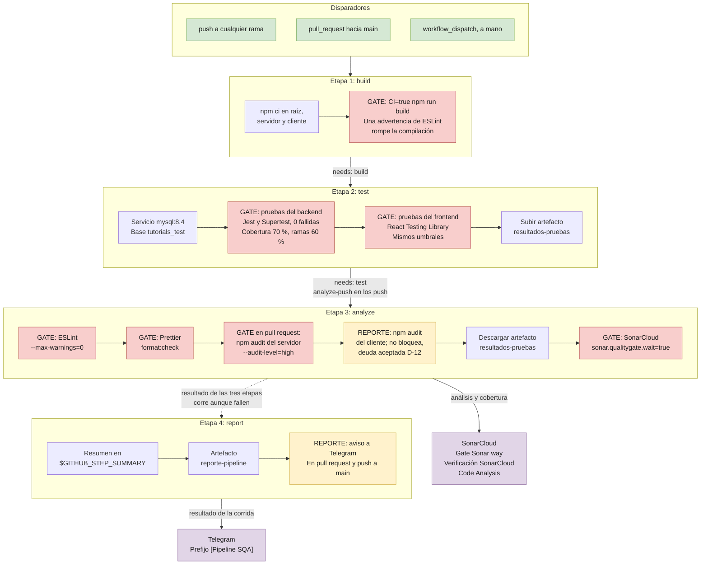
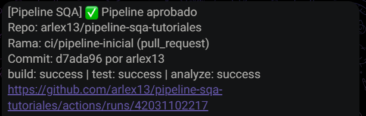
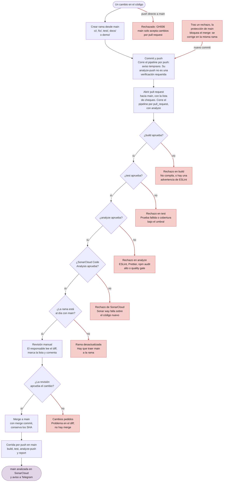

# Manual técnico

Explica cómo está armado el pipeline CI/CD, por qué se tomó cada decisión técnica y cómo mantenerlo. No repite métricas, porque cambian con cada corrida: las finales están en [Reporte-Mejora.md](Reporte-Mejora.md) y en los badges del [README](../README.md). Los umbrales se definen en el [SQA Plan](SQA-Plan.md).

| Dato              | Valor                                                                                              |
| ----------------- | -------------------------------------------------------------------------------------------------- |
| Repositorio       | [arlex13/pipeline-sqa-tutoriales](https://github.com/arlex13/pipeline-sqa-tutoriales), rama `main` |
| Pipeline          | [.github/workflows/ci.yml](../.github/workflows/ci.yml)                                            |
| Análisis estático | SonarCloud, organización `arlex13`, proyecto `arlex13_pipeline-sqa-tutoriales`                     |
| Versiones         | Node 24 en CI; MySQL 8.4 en CI y en Docker Compose                                                 |

## 1. Arquitectura del pipeline

Cada etapa es un job de GitHub Actions. Una etapa con `needs` solo corre si las anteriores aprueban. La excepción es `report`, que corre aunque fallen.



### 1.1 Disparadores

- **`push` a cualquier rama.** El filtro `branches: ["**"]` deja fuera los tags, que no disparan corridas.
- **`pull_request` hacia `main`.** En esta corrida, el job de análisis lleva el nombre `analyze`, que es el que exige la protección de `main`.
- **`workflow_dispatch`.** Permite lanzar el pipeline a mano desde la pestaña Actions.

`concurrency` agrupa las corridas por workflow, evento y rama, y cancela la anterior cuando llega una nueva. En `main` no cancela: cada corrida termina, porque su análisis define el estado de `main` en SonarCloud.

### 1.2 Etapas

**1. `build`.** Instala las dependencias con `npm ci` en la raíz, el servidor y el cliente, y compila el cliente con `CI=true npm run build`. Con `CI=true`, Create React App trata las advertencias de ESLint como errores, así que una advertencia del cliente detiene aquí el pipeline.

**2. `test`, necesita `build`.** Levanta un contenedor de servicio `mysql:8.4` con healthcheck y la base `tutorials_test`. Corre `npm run test:ci` en el servidor y en el cliente: Jest hace cumplir la cobertura con `coverageThreshold` y escribe `test-results.json`. El servidor usa `--runInBand`, para que los archivos de prueba no compitan por la misma base. Las pruebas del frontend y la subida del artefacto `resultados-pruebas` corren aunque falle el backend, para que una corrida roja también deje datos.

**3. `analyze`, necesita `test`.** Corre ESLint y `npm audit` en ambos paquetes, y Prettier en todo el repositorio. Después descarga `resultados-pruebas`, para que los `lcov.info` queden en las rutas de `sonar-project.properties`, y ejecuta SonarCloud con `sonar.qualitygate.wait=true`: el paso espera el resultado del quality gate y falla si no aprueba. El checkout usa `fetch-depth: 0`, porque SonarCloud necesita el historial para saber qué código es nuevo. El job se llama `analyze` en pull requests y `analyze-push` en los demás eventos (ver [DT-14](#43-pipeline)).

**4. `report`, necesita `build`, `test` y `analyze`.** Corre aunque fallen, con `if: ${{ !cancelled() }}`. Escribe en `$GITHUB_STEP_SUMMARY` el resultado de cada etapa, las pruebas y la cobertura, y publica ese resumen como artefacto `reporte-pipeline`. En pull requests y en `main` avisa a Telegram. El aviso lleva `continue-on-error: true`: si falla, se ve en la corrida, pero no la pone en rojo.

### 1.3 Gates

Cada gate hace fallar su etapa, y entonces la protección de `main` bloquea el merge. La última columna enlaza una corrida real en la que el gate rechazó el cambio; el número es el del pull request. El [#20](https://github.com/arlex13/pipeline-sqa-tutoriales/pull/20) y el [#21](https://github.com/arlex13/pipeline-sqa-tutoriales/pull/21) son demostraciones cerradas sin merge. Los gates marcados como configurados no se forzaron con una corrida: `test` se demostró con las regresiones, y SonarCloud y ESLint con dos pull requests propios, porque las regresiones fallan en `test` y nunca llegan a `analyze`.

| Gate                       | Umbral                                                             | Dónde falla                            | Corrida roja                                                                                                                                                            |
| -------------------------- | ------------------------------------------------------------------ | -------------------------------------- | ----------------------------------------------------------------------------------------------------------------------------------------------------------------------- |
| Compilación                | Sin errores ni advertencias de ESLint en el cliente                | `build`                                | Configurado                                                                                                                                                             |
| Pruebas                    | 0 fallidas                                                         | `test`                                 | [#18](https://github.com/arlex13/pipeline-sqa-tutoriales/actions/runs/42038649184) y [#19](https://github.com/arlex13/pipeline-sqa-tutoriales/actions/runs/42042336830) |
| Cobertura                  | 70 % de líneas, sentencias y funciones; 60 % de ramas, por paquete | `test`                                 | Configurado y medido                                                                                                                                                    |
| ESLint                     | 0 advertencias                                                     | `analyze`                              | [#21](https://github.com/arlex13/pipeline-sqa-tutoriales/actions/runs/42045513199)                                                                                      |
| Prettier                   | Sin diferencias                                                    | `analyze`                              | Configurado                                                                                                                                                             |
| `npm audit` del servidor   | 0 altas o críticas, en pull requests                               | `analyze`                              | Configurado                                                                                                                                                             |
| Quality gate de SonarCloud | Sonar way aprobado sobre el código nuevo                           | `analyze` y `SonarCloud Code Analysis` | [#20](https://github.com/arlex13/pipeline-sqa-tutoriales/actions/runs/42045496952)                                                                                      |

### 1.4 Protección de `main`

La regla está guardada en [regla-main.json](evidencia/proteccion/regla-main.json):

- Exige pull request.
- Exige las verificaciones `build`, `test`, `analyze` y `SonarCloud Code Analysis`, con la rama al día con `main`.
- `enforce_admins` está activo, así que también aplica al administrador.
- No exige aprobaciones.
- No permite force push ni borrar la rama.

Un push directo a `main` se rechaza con el error `GH006`: ver [push-directo.txt](evidencia/proteccion/push-directo.txt).

`report` no es una verificación requerida, porque queda en verde aunque fallen las etapas que resume.

### 1.5 Secretos

| Secreto              | Lo usa    | Para qué                        |
| -------------------- | --------- | ------------------------------- |
| `SONAR_TOKEN`        | `analyze` | Enviar el análisis a SonarCloud |
| `TELEGRAM_BOT_TOKEN` | `report`  | Enviar el mensaje con el bot    |
| `TELEGRAM_CHAT_ID`   | `report`  | Elegir el chat de destino       |

Ningún valor real va en un archivo versionado. `.env` está ignorado, y `.env.example` y `docker-compose.yml` solo traen marcadores como `cambia_esto`. La contraseña `ci_root` de CI es de un contenedor efímero y no es un secreto (ver [DT-15](#43-pipeline)).

### 1.6 Aviso a Telegram

Cada corrida de pull request o de `main` envía un mensaje con el resultado de las tres etapas, la rama, el commit y el enlace a la corrida.



## 2. Flujo de un cambio



Lo que el diagrama no alcanza a mostrar:

- Una rama con pull request abierto corre el pipeline dos veces, una por `push` y otra por `pull_request`. Es el comportamiento normal de GitHub con estos dos disparadores.
- Un defecto de comportamiento entra con dos commits: primero la prueba de regresión, con el pipeline en rojo, y después la corrección, con el pipeline en verde.
- La revisión manual no la hace cumplir GitHub, porque la protección exige cero aprobaciones. La define la [plantilla de pull request](../.github/pull_request_template.md). La sección 10 del [SQA Plan](SQA-Plan.md#10-revisión-de-código) dice cómo se aplicó.

## 3. La aplicación que protege el pipeline

Es el CRUD de tutoriales de bezkoder: React 18 con Create React App en el cliente, Express y Sequelize en el servidor, y MySQL. `app.js` crea la app sin `listen` ni `sync`, para que Supertest pueda importarla. `server.js` sincroniza la base y escucha en el puerto 8080.

Contrato de la API, ya con las correcciones de D-01, D-02 y D-03:

| Método   | Ruta                       | Éxito                          | Errores              |
| -------- | -------------------------- | ------------------------------ | -------------------- |
| `POST`   | `/api/tutorials`           | 201 con el tutorial creado     | 400 sin `title`; 500 |
| `GET`    | `/api/tutorials`           | 200; filtro opcional `?title=` | 500                  |
| `GET`    | `/api/tutorials/published` | 200                            | 500                  |
| `GET`    | `/api/tutorials/:id`       | 200                            | 404; 500             |
| `PUT`    | `/api/tutorials/:id`       | 200                            | 404; 500             |
| `DELETE` | `/api/tutorials/:id`       | 200                            | 404; 500             |
| `DELETE` | `/api/tutorials`           | 200                            | 500                  |

Cómo quedó cada corrección que afecta al código:

- **D-01.** Si `update` afecta 0 filas, el controlador consulta `findByPk` antes de responder 404, porque MySQL también informa 0 cuando los mismos datos llegan dentro del mismo segundo.
- **D-05 y D-06.** La configuración de la base sale de variables de entorno, y `app.js` quedó separado de `server.js`.
- **D-16.** `axios` está en la 0.35.
- **Issues de SonarCloud en la interfaz.** En la lista, cada tutorial es un botón dentro de un `<li>`, que también se puede usar con teclado. Title, Description y Status ya no usan `<label>` en el panel de detalle, porque no etiquetan ningún control. Los formularios conservan `<label htmlFor>` en Title y Description, porque ahí sí etiquetan un campo. Los componentes dejaron de escribir en la consola los datos que responde la API.

## 4. Decisiones técnicas

### 4.1 Base y repositorio

**DT-01. Aplicación base: el CRUD de bezkoder.** Lo sugirió el catedrático y coincide con el stack del enunciado: React, Express y MySQL. El enunciado excluye desarrollar una aplicación desde cero, así que se reutiliza esta base.

**DT-02. Repositorio nuevo y público, no un fork.** En un fork, los pull requests apuntan por defecto al repositorio original. Un repositorio nuevo también deja claro que el primer commit es la línea base. Es público porque el enunciado lo acepta y porque SonarCloud es gratuito para proyectos públicos. El crédito a bezkoder va en el README.

**DT-03. El primer commit es el código original, intacto y con finales de línea LF.** Lleva la etiqueta `v0-linea-base`, y sobre él se miden todas las métricas de "antes" ([Linea-Base-Calidad.md](Linea-Base-Calidad.md)). Git for Windows convierte a CRLF por defecto, lo que habría alterado la línea base. Por eso la importación usó `core.autocrlf=false`, y después `.gitattributes` fija LF.

**DT-04. npm como único gestor de paquetes.** El original no trae `package-lock.json`: el servidor no tiene lockfile y el cliente solo `yarn.lock`. `npm ci` necesita un lockfile para instalar siempre las mismas versiones. Se generaron tres, en la raíz, el servidor y el cliente, y se eliminó `yarn.lock`.

**DT-05. Create React App se queda.** Está descontinuado y `react-scripts` arrastra dependencias vulnerables, pero migrar a otro framework amplía el alcance. Queda como deuda técnica aceptada, D-12, documentada en el SQA Plan y visible en cada corrida por el `npm audit` del cliente.

**DT-06. 28 pruebas.** Bastan para los tres tipos de prueba que pide el enunciado y para la cobertura que exige SonarCloud. El diseño está en [Matriz-Pruebas.md](Matriz-Pruebas.md).

### 4.2 Gates y análisis estático

**DT-07. Cobertura de 70 %, y 60 % en ramas.** Son 70 % de líneas, sentencias y funciones, y 60 % de ramas, en backend y frontend por igual. Jest lo hace cumplir con `coverageThreshold`, y la etapa `test` falla si no se alcanza. El enunciado exige como mínimo 60 %, y el proyecto nunca baja de ahí para hacer pasar el pipeline.

**DT-08. SonarCloud como análisis principal, junto con ESLint y Prettier.** ESLint y Prettier revisan errores comunes y formato en cada corrida. SonarCloud agrega deuda técnica, vulnerabilidades, duplicación y el gate sobre el código nuevo. Corre con `sonar.qualitygate.wait=true` porque, sin esa opción, el paso publicaría el análisis y terminaría en verde aunque el gate fallara. El análisis automático de SonarCloud está apagado, porque choca con el escáner por CI.

**DT-09. Quality gate Sonar way, con plan OSS.** El plan OSS es gratuito para proyectos públicos y permite gates propios, pero se mantiene Sonar way: es un estándar externo, conocido y difícil de relajar a conveniencia. Se aplica al código nuevo y complementa a Jest, que controla el total de cada paquete. La definición de código nuevo es Previous version, con versión `0.0.0` en la línea base y `1.0.0` en CI. Las condiciones del gate están en la sección 6.2 del [SQA Plan](SQA-Plan.md).

**DT-10. Perfil Sonar way comprehensive.** El perfil predeterminado, `Sonar way core`, tiene 249 reglas en JavaScript y deja la línea base casi vacía. `Sonar way comprehensive` tiene 481. Se eligió antes de medir la línea base y no se cambia, para que el antes y el después se midan con las mismas reglas.

**DT-11. Dos configuraciones de ESLint.** El servidor usa ESLint 10 con configuración plana, en `eslint.config.mjs`, con `recommended`, `no-var`, `eqeqeq` y `no-unused-vars`. El cliente usa el ESLint 8 que trae Create React App, que no admite la versión nueva, con `.eslintrc.json`, `"root": true` y las reglas `react-app` y `react-app/jest`. El cliente agrega `no-var`, porque `react-app` no la trae. En ambos, `--max-warnings=0` convierte cualquier advertencia en un fallo.

**DT-12. El `npm audit` del servidor solo bloquea en pull requests.** Corre con `--audit-level=high`, así que solo lo detienen los avisos altos o críticos. En los push lleva `continue-on-error`, porque la base de avisos cambia sola, y un aviso nuevo no debe poner `main` en rojo sin que haya cambiado el código. En el pull request sí bloquea, porque ahí se decide si el cambio entra.

**DT-13. El `npm audit` del cliente no bloquea.** Lleva siempre `continue-on-error: true`, por la deuda aceptada D-12: casi todos sus avisos llegan por `react-scripts`. Un gate aquí bloquearía todos los pull requests, y la única salida sería migrar. El reporte queda visible en cada corrida. `axios`, la dependencia directa con aviso alto, sí se actualizó (D-16).

### 4.3 Pipeline

**DT-14. Dos disparadores y nombre condicional de `analyze`.** `push` a cualquier rama cumple literalmente el "en cada push/PR" del enunciado y avisa antes de abrir un pull request. `pull_request` hacia `main` evalúa el cambio antes del merge, y su análisis es el que SonarCloud asocia al pull request. Una rama con pull request abierto corre dos veces. Se acepta, y `concurrency` cancela las corridas obsoletas.

La corrida de `push` es más permisiva, porque su `npm audit` no bloquea. Con un solo nombre, esa corrida podría dar por aprobada la verificación requerida. Por eso el job se llama distinto según el evento:

```yaml
name: ${{ github.event_name == 'pull_request' && 'analyze' || 'analyze-push' }}
```

**DT-15. MySQL real en CI.** Las pruebas de integración corren contra un contenedor de servicio `mysql:8.4`, la misma versión de Docker Compose. Una base simulada no habría mostrado comportamientos como las 0 filas afectadas de un `PUT` sin cambios (D-01, prueba RG-02). El contenedor solo vive durante la corrida, por eso su contraseña `ci_root` no es un secreto.

**DT-16. Jest sin `roots`.** `collectCoverageFrom` mide todo `app.js` y `app/`. Con `roots`, un archivo de `app/` que ninguna prueba cargara quedaría fuera del umbral, y un módulo nuevo sin pruebas pasaría el gate.

**DT-17. Base de prueba protegida.** Las pruebas con base de datos usan `sync({ force: true })`, que borra las tablas. Hay dos protecciones: `tests/setup-env.js` fija `DB_NAME=tutorials_test` antes de cargar la app, aunque `.env` apunte a otra base, y `tests/helpers/base-de-prueba.js` aborta si el nombre de la base no termina en `_test`.

**DT-18. `report` corre siempre.** Lleva `if: ${{ !cancelled() }}`, y las pruebas del frontend y la subida de resultados corren aunque falle el backend. Una corrida roja también deja datos: de ahí salen los resultados "antes de la corrección" de la matriz.

**DT-19. Filtro de dos avisos en las pruebas del cliente.** `react-client/src/setupTests.js` omite solo `React Router Future Flag Warning` y `ReactDOMTestUtils.act`: las dependencias fijadas los repiten en cada prueba y el proyecto no las migra. Los demás avisos siguen apareciendo en el log, y el filtro no afecta los resultados ni la cobertura.

### 4.4 Proceso

**DT-20. Protección de `main` justo después del primer merge, sin aprobaciones obligatorias.** Los nombres de las verificaciones deben existir antes de exigirlos, y `SonarCloud Code Analysis` la publica la app de SonarCloud en cada pull request. El proyecto es individual y GitHub no permite aprobar el propio pull request, así que exigir una aprobación bloquearía todo merge.

**DT-21. Cada prueba de regresión entra con su corrección, en dos commits.** Primero la prueba sola, con el pipeline en rojo, y después la corrección, con el pipeline en verde. Así el historial demuestra que la prueba detecta el defecto. Los merges usan merge commit, nunca squash ni rebase, para que esos dos commits conserven sus SHA.

**DT-22. Dos pull requests de demostración, cerrados sin merge.** Las regresiones fallan en `test` y nunca llegan a `analyze`, así que no demuestran SonarCloud ni ESLint.

**DT-23. Defectos en GitHub Issues.** Cada defecto D-n tiene un issue con etiqueta de tipo y de prioridad, y se cierra desde el pull request que lo corrige, con `Closes #n`. Los que no se corrigen llevan la etiqueta `riesgo-aceptado` o `deuda-tecnica`, con su motivo en el SQA Plan.

**DT-24. Las cifras salen de un archivo de medición.** Reporte, matriz y diapositivas toman los números de un archivo generado por script, para que no haya cifras escritas a mano. `v1.0.0` marca el estado final del código y no se mueve: la documentación posterior no cambia lo medido.

**DT-25. Español en documentación, commits, issues y pull requests.** El código original conserva sus nombres en inglés, y los mensajes de la interfaz y de la API siguen en inglés, como en la aplicación original.

### 4.5 Opcionales

**DT-26. Variables de entorno y Docker Compose solo con MySQL.** Las credenciales salieron del código a variables de entorno con `dotenv`. Se versiona `.env.example` y se ignora `.env`. `docker-compose.yml` levanta MySQL 8.4, con volumen y healthcheck, y publica el puerto solo en `127.0.0.1`. La API y el cliente corren en el equipo: el enunciado no exige imágenes propias.

**DT-27. Telegram para las notificaciones.** El enunciado lista correo, Slack y Discord como notificaciones automáticas, y permite proponer variantes justificando la decisión. Cambia el canal, pero el aviso automático del resultado del pipeline se mantiene. Se eligió porque ya existía un bot propio. La API se llama con `curl`, sin acciones de terceros. El prefijo `[Pipeline SQA]` distingue estos mensajes de los de otros proyectos en el mismo chat. Solo avisa en `pull_request` y en `main`, para no duplicar mensajes, y en un pull request usa el SHA de la rama, no el del commit de merge que arma GitHub.

**DT-28. Opcionales que no se implementaron.** Despliegue automático en la nube y pruebas end-to-end. El enunciado no los exige, y el despliegue además necesitaría un MySQL en la nube.

## 5. Guía de mantenimiento

### 5.1 Agregar pruebas

| Tipo                  | Dónde                                    | ID    | Cómo                                                           |
| --------------------- | ---------------------------------------- | ----- | -------------------------------------------------------------- |
| Unitaria del backend  | `node-express-server/tests/unit/`        | `UT-` | Simula el modelo con `jest.mock`                               |
| Integración           | `node-express-server/tests/integration/` | `IT-` | Supertest contra `app.js` y MySQL real                         |
| Regresión del backend | `node-express-server/tests/regression/`  | `RG-` | Supertest y MySQL real                                         |
| Frontend              | `react-client/src/`, junto al componente | `FE-` | React Testing Library, simulando `TutorialDataService` o axios |

Pasos:

1. Agrega el caso a [Matriz-Pruebas.md](Matriz-Pruebas.md), con su ID, tipo, entrada y resultado esperado.
2. Escribe la prueba con el ID al inicio del título, por ejemplo `it("RG-05 ...")`. Así la matriz se cruza con los resultados de Jest.
3. Córrela en local (ver [5.4](#54-correr-todo-en-local)).
4. Si cubre un defecto de comportamiento, haz dos commits: la prueba sola, con el pipeline en rojo, y la corrección, con el pipeline en verde y `Closes #n` en el pull request.

Conviene saber:

- Las pruebas que usan la base llaman a `prepararBaseDePrueba` y a `cerrarBaseDePrueba`, de `tests/helpers/base-de-prueba.js`.
- Create React App trae `resetMocks: true`, que limpia los mocks antes de cada prueba. Por eso se configuran en `beforeEach`.
- Create React App solo busca pruebas en `src/`.
- Todo archivo nuevo de `app/` cuenta para la cobertura, aunque ninguna prueba lo cargue.
- Si un archivo queda fuera de la medición de Jest a propósito, agrégalo también a `sonar.coverage.exclusions`, para que Jest y SonarCloud midan lo mismo.
- Sonar way exige 80 % sobre el código nuevo. Por eso la meta de trabajo es 85 %, aunque el umbral de Jest sea 70 %.

### 5.2 Cambiar umbrales

| Qué se cambia          | Dónde                                                                   |
| ---------------------- | ----------------------------------------------------------------------- |
| Cobertura del servidor | `coverageThreshold.global` en `node-express-server/jest.config.js`      |
| Cobertura del cliente  | `jest.coverageThreshold.global` en `react-client/package.json`          |
| Advertencias de ESLint | `--max-warnings=0`, en el script `lint` de cada `package.json`          |
| Reglas de ESLint       | `node-express-server/eslint.config.mjs` y `react-client/.eslintrc.json` |
| Formato                | `.prettierrc` y `.prettierignore`                                       |
| Nivel de `npm audit`   | `--audit-level=high`, en los dos pasos de `ci.yml`                      |
| Quality gate           | SonarCloud, Administration, Quality Gate                                |

Reglas:

- La cobertura nunca baja de 60 %, que es el mínimo del enunciado.
- Un umbral no se baja para hacer pasar el pipeline. Si hay una razón legítima, se documenta la excepción.
- La cobertura se cambia en los dos paquetes por igual.
- El cambio entra por pull request y actualiza la sección 6 del [SQA Plan](SQA-Plan.md).
- `-Dsonar.projectVersion=1.0.0`, en `ci.yml`, no se cambia sin una razón: con la definición Previous version, una versión nueva reinicia lo que SonarCloud considera código nuevo en `main`.

### 5.3 Rotar secrets

`gh secret set` pide el valor sin dejarlo en el historial de la terminal. Un secreto nunca se pega en un chat, un commit o un log.

**`SONAR_TOKEN`.** Dura 90 días, y el vigente vence alrededor del 2 de febrero de 2027. Si vence, `analyze` falla en el paso de SonarCloud y ningún pull request puede entrar.

1. En SonarCloud, ve a My Account, Security, y genera un token nuevo.
2. Cárgalo con `gh secret set SONAR_TOKEN -R arlex13/pipeline-sqa-tutoriales`.
3. Comprueba con una corrida: `gh workflow run ci.yml -R arlex13/pipeline-sqa-tutoriales --ref main`.
4. Revoca el token anterior en SonarCloud.

**`TELEGRAM_BOT_TOKEN`.**

1. En Telegram, pide a `@BotFather` un token nuevo con `/revoke`.
2. Cárgalo con `gh secret set TELEGRAM_BOT_TOKEN -R arlex13/pipeline-sqa-tutoriales`.
3. Actualízalo también en cualquier otro proyecto que use ese bot.
4. Comprueba que llegue el mensaje. El paso `Notificar a Telegram` lleva `continue-on-error`, así que un token malo no pone la corrida en rojo: hay que abrir el paso o mirar el chat.

**`TELEGRAM_CHAT_ID`.** Solo cambia si cambia el chat de destino. Se carga igual.

### 5.4 Correr todo en local

Hacen falta Node 24 y Docker Desktop. Estos comandos repiten `build`, `test` y `analyze`, sin SonarCloud, desde la raíz del repositorio. Para las pruebas basta `docker compose up -d --wait`: `tests/setup-env.js` trae los valores de Docker Compose y no hace falta un `.env`.

**Git Bash:**

```bash
docker compose up -d --wait

# Etapa build
npm ci --no-audit --no-fund
cd node-express-server
npm ci --no-audit --no-fund
cd ../react-client
npm ci --no-audit --no-fund
CI=true npm run build

# Etapa test
CI=true npm run test:ci
cd ../node-express-server
npm run test:ci

# Etapa analyze, sin SonarCloud
npm run lint
npm audit --audit-level=high
cd ../react-client
npm run lint
npm audit --audit-level=high # Falla por la deuda D-12: es lo esperado
cd ..
npm run format:check
```

**PowerShell.** `CI=true npm test` no funciona, porque PowerShell lee `CI=true` como el nombre de un comando. La variable se define aparte con `$env:CI` y dura hasta que se borra. Windows PowerShell 5.1 tampoco admite `&&`, así que cada comando va en su línea.

```powershell
docker compose up -d --wait

# Etapa build
npm ci --no-audit --no-fund
Set-Location node-express-server
npm ci --no-audit --no-fund
Set-Location ..\react-client
npm ci --no-audit --no-fund
$env:CI = "true"
npm run build

# Etapa test
npm run test:ci
Set-Location ..\node-express-server
npm run test:ci

# Etapa analyze, sin SonarCloud
npm run lint
npm audit --audit-level=high
Set-Location ..\react-client
npm run lint
npm audit --audit-level=high # Falla por la deuda D-12: es lo esperado
Set-Location ..
npm run format:check
Remove-Item Env:CI
```

**La aplicación completa.** Los pasos están en [Manual-Uso.md](Manual-Uso.md).

**SonarCloud.** Corre en CI. El comando con el que se midió la línea base está en la sección 2.1 de [Linea-Base-Calidad.md](Linea-Base-Calidad.md).

### 5.5 Cambiar versiones o etapas

- **Node.** `NODE_VERSION` en `ci.yml`. Antes de cambiarlo, comprueba que `react-scripts` 5 compile con la versión nueva.
- **MySQL.** `image: mysql:8.4` en `ci.yml` y en `docker-compose.yml`.
- **Acciones de GitHub.** `actions/checkout` v7, `actions/setup-node` v7, `actions/upload-artifact` v7, `actions/download-artifact` v8 y `SonarSource/sonarqube-scan-action` v8.
- **Renombrar una etapa.** Si cambia el nombre de `build`, `test` o `analyze`, actualiza también la protección de `main`. Un nombre requerido que no coincide con ninguna verificación real deja el merge bloqueado para siempre. La regla vigente se lee con `gh api repos/arlex13/pipeline-sqa-tutoriales/branches/main/protection`.

## 6. Solución de problemas

### 6.1 `npm ci` falla porque el lockfile del servidor no está en el repositorio

- **Causa.** El `.gitignore` original de `node-express-server` incluye `package-lock.json`, así que Git no sube ese archivo, y `npm ci` lo necesita.
- **Solución.** El commit `b84777e` quitó esa línea.
- **Comprobación.** `git ls-files | grep package-lock` en Git Bash, o `git ls-files | Select-String package-lock` en PowerShell, debe listar tres archivos.

### 6.2 El análisis automático de SonarCloud está activo

- **Qué se ve.** Al importar el proyecto, SonarCloud lanza solo un primer análisis automático, con el perfil predeterminado y sin versión.
- **Por qué importa.** El escáner por CI falla mientras el análisis automático esté activo, y la línea base debe medirse con la misma configuración que el estado final.
- **Solución.** Se apagó en SonarCloud, en Administration, Analysis Method. La línea base es el análisis con versión `0.0.0`.

### 6.3 El volumen de MySQL ya tiene datos

- **Qué se ve.** Las pruebas de integración no pueden usar `tutorials_test`, o un cambio en `DB_USER` o `DB_PASSWORD` no tiene efecto.
- **Causa.** MySQL aplica `docker/mysql-init/01-base-de-pruebas.sql` y las variables `MYSQL_*` solo cuando arranca con el volumen vacío. Lo avisa el comentario inicial de `docker-compose.yml`.
- **Solución.** `docker compose down -v` y después `docker compose up -d --wait`. La opción `-v` borra el volumen, con los datos locales de la aplicación.
- **Aviso.** Un `DB_USER` distinto también exige cambiar el `GRANT` de ese script.

### 6.4 Las pruebas fallan con `Connection lost`

- **Causa.** MySQL todavía está arrancando.
- **Solución.** `docker compose up -d --wait`, que espera a que el servicio esté sano antes de volver.

### 6.5 Avisos de `npm audit`

Los ejemplos salen de esta [corrida en verde](https://github.com/arlex13/pipeline-sqa-tutoriales/actions/runs/42073629992).

- **El paso del cliente termina con error y el job queda en verde.** Es lo esperado. El paso lleva `continue-on-error: true` por la deuda D-12. Por eso una corrida verde muestra `1 error` en Annotations.
- **El paso del servidor lista vulnerabilidades y aprueba.** `--audit-level=high` solo falla con avisos altos o críticos. Los moderados y bajos quedan como reporte.
- **Un pull request queda bloqueado por un aviso alto del servidor.** Es el gate funcionando. Se actualiza la dependencia, y no se desactiva el gate. `analyze-push` puede seguir en verde: la verificación que cuenta es `analyze`.
- **No uses `npm audit fix --force`.** En esa corrida propone instalar `react-scripts@0.0.0` en el cliente, y `sequelize@3.30.0` y `eslint@9.39.5` en el servidor. Son cambios incompatibles.

### 6.6 `analyze` aparece con un nombre extraño

- **Qué se ve.** Si `test` falla, la lista de jobs muestra `github.event_name == 'pull_request' && 'analyze' || 'analyze-push'` en vez del nombre, con el job omitido, como en esta [corrida](https://github.com/arlex13/pipeline-sqa-tutoriales/actions/runs/42038649184).
- **Causa.** El job queda omitido, y GitHub muestra la expresión de su nombre sin evaluarla.
- **Solución.** Ninguna: es solo visual. El rechazo real está en `test`, y el merge sigue bloqueado.

### 6.7 Un `PUT` sin cambios parece un id inexistente

- **Qué se ve.** Con el código original, varios `PUT` iguales dentro del mismo segundo a un id existente respondían `Cannot update Tutorial`. La ráfaga medida está en [defectos.txt](evidencia/linea-base/defectos.txt).
- **Causa.** MySQL informa 0 filas afectadas cuando los datos no cambian, y `updatedAt` guarda segundos. Así que 0 filas no significa que el id no exista.
- **Solución.** Si `update` afecta 0 filas, el controlador consulta `findByPk`: responde 200 si el id existe y 404 si no. Simplificarlo a "0 filas es 404" podría hacer fallar RG-02.

### 6.8 El aviso de Telegram no llega y el paso sale en verde

- **Causa.** El paso lleva `continue-on-error: true`, que oculta el fallo.
- **Solución.** Abre el log del paso `Notificar a Telegram` en la corrida. Si dice `Unauthorized`, rota el token según [5.3](#53-rotar-secrets).

### 6.9 Un pull request vuelve a `BLOCKED` después de otro merge

- **Causa.** La protección usa `strict`: la rama debe estar al día con `main`.
- **Solución.** El botón **Update branch** en GitHub, o `gh pr update-branch <n> -R arlex13/pipeline-sqa-tutoriales`, y esperar la corrida nueva.
