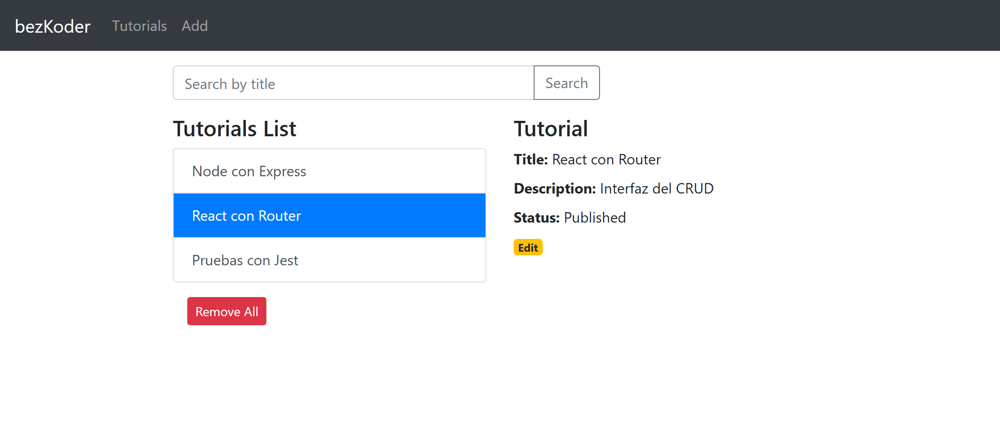
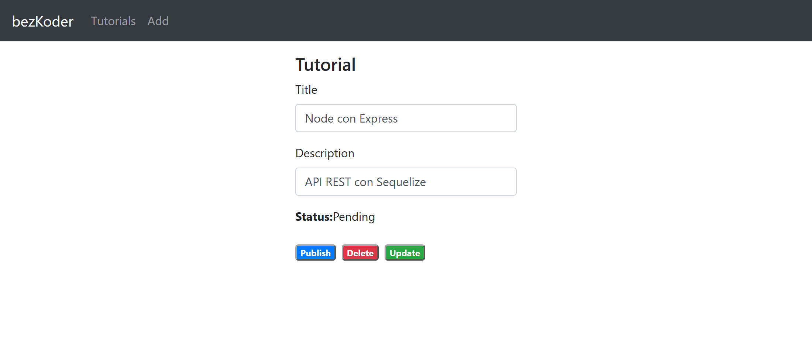

# Manual de uso

Cómo instalar y usar la aplicación de tutoriales. Los textos de la interfaz están en inglés, como en la aplicación original, y aquí se citan tal como aparecen en pantalla.

Cada tutorial tiene un título (`Title`), una descripción (`Description`) y un estado (`Status`), que es `Pending` (pendiente) o `Published` (publicado).

## 1. Instalación

Necesitas Git y Node.js 24 con npm. Para la base de datos, Docker con Docker Compose o un MySQL propio. El pipeline usa Node.js 24 y MySQL 8.4.

La aplicación corre en dos terminales, una para la API y otra para el cliente:

| Qué        | Dirección                             |
| ---------- | ------------------------------------- |
| Aplicación | <http://localhost:8081>               |
| API        | <http://localhost:8080/api/tutorials> |

### 1.1 Con Docker

Docker Compose levanta solo MySQL. La API y el cliente corren en tu equipo con `npm start`.

```bash
git clone https://github.com/arlex13/pipeline-sqa-tutoriales.git
cd pipeline-sqa-tutoriales
docker compose up -d --wait
cd node-express-server
cp .env.example .env
npm ci
npm start
```

En PowerShell, cambia `cp` por `Copy-Item`. El archivo `.env.example` ya trae los mismos valores de `docker-compose.yml`, que son marcadores de desarrollo y no secretos.

La API debe mostrar `Server is running on port 8080.` y `Synced db.`. En otra terminal, desde la raíz del repositorio:

```bash
cd react-client
npm ci
npm start
```

Para detener todo, pulsa `Ctrl+C` en las dos terminales y ejecuta `docker compose down` en la raíz del repositorio. Los tutoriales se conservan en un volumen de Docker; `docker compose down -v` los borra.

### 1.2 Sin Docker

Crea las bases y el usuario en tu MySQL, como administrador y con tu propia contraseña. La aplicación crea la tabla al arrancar, pero no la base.

```sql
CREATE DATABASE tutorials;
CREATE DATABASE tutorials_test; -- Solo para las pruebas del servidor
CREATE USER 'tutorials_app'@'localhost' IDENTIFIED BY 'tu_clave';
GRANT ALL PRIVILEGES ON tutorials.* TO 'tutorials_app'@'localhost';
GRANT ALL PRIVILEGES ON tutorials_test.* TO 'tutorials_app'@'localhost';
```

Sigue los pasos de la sección 1.1 sin `docker compose up -d --wait`, y escribe tu contraseña en `DB_PASSWORD`, dentro de `node-express-server/.env`, antes de `npm start`. Si la API muestra `Failed to sync db: ...`, revisa los valores de ese archivo.

Las variables de entorno y los problemas de instalación están en el [README](../README.md).

## 2. Pantallas

| Pantalla | Dirección          | Cómo se llega                             |
| -------- | ------------------ | ----------------------------------------- |
| Lista    | `/` o `/tutorials` | Menú `Tutorials` o marca `bezKoder`       |
| Alta     | `/add`             | Menú `Add`                                |
| Edición  | `/tutorials/<id>`  | Enlace `Edit` de un tutorial seleccionado |





## 3. Cómo se muestran los errores

La aplicación no muestra errores en pantalla. Si algo falla, no aparece ningún mensaje y el error queda en la consola del navegador (F12, pestaña Console). Es el comportamiento de la aplicación original, y en la pantalla de edición queda registrado como el defecto abierto [D-15](https://github.com/arlex13/pipeline-sqa-tutoriales/issues/15).

Con D-01 corregido, ya no hay un éxito falso: si la API rechaza un cambio, `The tutorial was updated successfully!` no aparece.

## 4. Cómo usar la aplicación

### 4.1 Crear un tutorial

1. Pulsa `Add` en el menú.
2. Escribe `Title` y, si quieres, `Description`.
3. Pulsa `Submit`.

| Caso                       | Qué ve el usuario                                                                                                               |
| -------------------------- | ------------------------------------------------------------------------------------------------------------------------------- |
| Se guardó                  | `You submitted successfully!` y un botón `Add` que vuelve al formulario vacío. El tutorial queda en `Pending`                   |
| `Title` está vacío         | Ningún mensaje: el formulario sigue igual. La API respondió 400 con `Content can not be empty!`, y eso solo se ve en la consola |
| La API falla o no responde | Ningún mensaje: el formulario sigue igual, con lo escrito. El error queda en la consola                                         |

### 4.2 Listar y ver el detalle

1. Pulsa `Tutorials` en el menú.
2. Haz clic en un tutorial de la lista. Cada fila es un botón, así que también se puede elegir con Tab y Enter.
3. La fila queda resaltada y el panel derecho muestra `Tutorial`, `Title:`, `Description:`, `Status:` y el enlace `Edit`.

Mientras no hay selección, el panel muestra `Please click on a Tutorial...`. Si la lista no se pudo cargar, aparece vacía, sin mensaje.

### 4.3 Buscar por título

1. Escribe parte del título en `Search by title`.
2. Pulsa `Search`. La tecla Enter no inicia la búsqueda.

| Caso                       | Qué ve el usuario                                                   |
| -------------------------- | ------------------------------------------------------------------- |
| Hay coincidencias          | La lista muestra solo los tutoriales cuyo título contiene ese texto |
| No hay coincidencias       | La lista queda vacía, sin mensaje                                   |
| El campo está vacío        | La lista muestra todos los tutoriales. Así se quita un filtro       |
| La API falla o no responde | La lista no cambia. Ningún mensaje; el error queda en la consola    |

En todos los casos se pierde la selección y el panel derecho vuelve a `Please click on a Tutorial...`.

### 4.4 Editar un tutorial

1. Selecciona el tutorial y pulsa `Edit`.
2. Cambia `Title` o `Description`.
3. Pulsa `Update`.

| Caso                                 | Qué ve el usuario                                                           |
| ------------------------------------ | --------------------------------------------------------------------------- |
| Se guardó, aunque no hubiera cambios | `The tutorial was updated successfully!`                                    |
| Falló                                | Ningún mensaje y los datos siguen en pantalla. El error queda en la consola |

Para volver a la lista, pulsa `Tutorials` en el menú.

Si abres la dirección de un tutorial que no existe, la pantalla aparece en blanco, con `Status:Pending` y sin mensaje. Si la API no responde, se ve igual.

### 4.5 Publicar o despublicar

1. Abre el tutorial con `Edit`.
2. Pulsa `Publish` si está en `Pending`, o `UnPublish` si está en `Published`.

`Status:` cambia y el botón cambia, sin mensaje propio. Si falla, el estado no cambia y el error queda en la consola.

`Publish` y `UnPublish` también guardan lo que esté escrito en `Title` y `Description`, aunque no hayas pulsado `Update`. La interfaz no tiene un filtro de publicados; para consultarlos se usa la API.

### 4.6 Eliminar un tutorial

1. Abre el tutorial con `Edit`.
2. Pulsa `Delete`. No pide confirmación.

Vuelve a la lista, ya sin ese tutorial y sin mensaje. Si falla, sigue en la pantalla de edición y el error queda en la consola.

### 4.7 Eliminar todos los tutoriales

1. Pulsa `Tutorials` en el menú.
2. Pulsa `Remove All`. No pide confirmación y no se puede deshacer.

`Remove All` borra todos los tutoriales de la base, no solo los que muestra una búsqueda. La lista queda vacía y el panel derecho muestra `Please click on a Tutorial...`. Si falla, la lista no cambia y el error queda en la consola.

## 5. API

La API recibe y responde JSON en `http://localhost:8080/api/tutorials`. No tiene autenticación.

### 5.1 Rutas y códigos de respuesta

| Método   | Ruta                       | Acción                                            | Éxito                      | Errores  |
| -------- | -------------------------- | ------------------------------------------------- | -------------------------- | -------- |
| `POST`   | `/api/tutorials`           | Crear                                             | 201 con el tutorial creado | 400, 500 |
| `GET`    | `/api/tutorials`           | Listar; `?title=` filtra por coincidencia parcial | 200 con la lista           | 500      |
| `GET`    | `/api/tutorials/published` | Listar los publicados                             | 200 con la lista           | 500      |
| `GET`    | `/api/tutorials/:id`       | Obtener uno                                       | 200 con el tutorial        | 404, 500 |
| `PUT`    | `/api/tutorials/:id`       | Actualizar los campos enviados                    | 200 con un mensaje         | 404, 500 |
| `DELETE` | `/api/tutorials/:id`       | Eliminar uno                                      | 200 con un mensaje         | 404, 500 |
| `DELETE` | `/api/tutorials`           | Eliminar todos                                    | 200 con un mensaje         | 500      |

Al crear, solo `title` es obligatorio y `published` vale `false` si no se envía.

### 5.2 Mensajes de la API

Las respuestas con mensaje tienen la forma `{"message":"..."}`.

| Ruta                                                  | Código | `message`                                                                   |
| ----------------------------------------------------- | ------ | --------------------------------------------------------------------------- |
| `POST /api/tutorials`                                 | 400    | `Content can not be empty!` cuando falta `title` o está vacío               |
| `POST /api/tutorials`                                 | 500    | El mensaje del error, o `Some error occurred while creating the Tutorial.`  |
| `GET /api/tutorials` y `GET /api/tutorials/published` | 500    | El mensaje del error, o `Some error occurred while retrieving tutorials.`   |
| `GET /api/tutorials/:id`                              | 404    | `Cannot find Tutorial with id=5.`                                           |
| `GET /api/tutorials/:id`                              | 500    | `Error retrieving Tutorial with id=5`                                       |
| `PUT /api/tutorials/:id`                              | 200    | `Tutorial was updated successfully.`                                        |
| `PUT /api/tutorials/:id`                              | 404    | `Cannot update Tutorial with id=5. Tutorial was not found.`                 |
| `PUT /api/tutorials/:id`                              | 500    | `Error updating Tutorial with id=5`                                         |
| `DELETE /api/tutorials/:id`                           | 200    | `Tutorial was deleted successfully!`                                        |
| `DELETE /api/tutorials/:id`                           | 404    | `Cannot delete Tutorial with id=5. Tutorial was not found.`                 |
| `DELETE /api/tutorials/:id`                           | 500    | `Could not delete Tutorial with id=5`                                       |
| `DELETE /api/tutorials`                               | 200    | `3 Tutorials were deleted successfully!`, con la cantidad eliminada         |
| `DELETE /api/tutorials`                               | 500    | El mensaje del error, o `Some error occurred while removing all tutorials.` |

- **Id no numérico.** `GET /api/tutorials/abc` responde 404, pero `PUT` y `DELETE` con ese id responden 500. Es el defecto abierto [D-14](https://github.com/arlex13/pipeline-sqa-tutoriales/issues/14).
- **`PUT` sin cambios.** MySQL informa 0 filas cuando los mismos datos llegan dentro del mismo segundo. Por eso, si `update` afecta 0 filas, el servidor consulta el id con `findByPk`: responde 200 si existe y 404 si no.
- **Comprobar que la API está activa.** `GET http://localhost:8080/` responde `{"message":"Welcome to bezkoder application."}`. No es una de las siete rutas de tutoriales.

### 5.3 Ejemplos

En Git Bash:

```bash
# Crear
curl -i -X POST http://localhost:8080/api/tutorials \
  -H "Content-Type: application/json" \
  -d '{"title":"Node","description":"Curso de Node"}'

# Buscar por título
curl -i "http://localhost:8080/api/tutorials?title=Node"

# Publicar el tutorial 1
curl -i -X PUT http://localhost:8080/api/tutorials/1 \
  -H "Content-Type: application/json" \
  -d '{"published":true}'

# Eliminar el tutorial 1
curl -i -X DELETE http://localhost:8080/api/tutorials/1
```

En PowerShell:

```powershell
# Crear
Invoke-RestMethod -Method Post -Uri http://localhost:8080/api/tutorials -ContentType "application/json" -Body '{"title":"Node","description":"Curso de Node"}'

# Buscar por título
Invoke-RestMethod -Uri "http://localhost:8080/api/tutorials?title=Node"

# Publicar el tutorial 1
Invoke-RestMethod -Method Put -Uri http://localhost:8080/api/tutorials/1 -ContentType "application/json" -Body '{"published":true}'

# Eliminar el tutorial 1
Invoke-RestMethod -Method Delete -Uri http://localhost:8080/api/tutorials/1
```

## 6. Limitaciones conocidas

Vienen de la aplicación base y no se cambiaron:

- **Sin autenticación.** Cualquiera que alcance la API puede borrar todos los tutoriales. Es el riesgo aceptado [D-04](https://github.com/arlex13/pipeline-sqa-tutoriales/issues/4), descrito en el [SQA Plan](SQA-Plan.md#111-riesgos-aceptados).
- **Sin confirmación.** `Delete` y `Remove All` borran de inmediato.
- **Título sin validar al editar.** La validación de `title` solo está en `POST`: si `Title` queda vacío en la pantalla de edición, se guarda vacío.
- **Errores sin mensaje.** Ninguna pantalla muestra errores, como explica la [sección 3](#3-cómo-se-muestran-los-errores).
- **Búsqueda sin codificar.** El texto se envía tal cual en la URL, así que `#` y `&` lo cortan: buscar `C#` equivale a buscar `C`, y `a&b` a buscar `a`.

## 7. Problemas frecuentes

| Qué ves                                                        | Causa probable                                                                                                     | Qué hacer                                                                                                           |
| -------------------------------------------------------------- | ------------------------------------------------------------------------------------------------------------------ | ------------------------------------------------------------------------------------------------------------------- |
| La lista aparece vacía, sin mensaje                            | No hay tutoriales, la API no responde o abriste la aplicación en una dirección distinta de `http://localhost:8081` | Mira la consola del navegador. Si dice `Network Error`, revisa la terminal de la API y abre `http://localhost:8081` |
| `Submit` no hace nada                                          | `Title` está vacío o la API no responde                                                                            | Escribe un título. Si sigue igual, mira la consola del navegador                                                    |
| La pantalla de edición aparece en blanco, con `Status:Pending` | La dirección apunta a un tutorial que no existe, o la API no responde                                              | Pulsa `Tutorials` y elige un tutorial de la lista                                                                   |
| `Update` no muestra ningún mensaje                             | La API rechazó el cambio, por ejemplo porque el tutorial se eliminó después de abrir la pantalla                   | Mira la consola del navegador y pulsa `Tutorials` para volver a la lista actualizada                                |
| La API muestra `Failed to sync db: ...`                        | MySQL no está listo, o los valores de `.env` no coinciden con los de MySQL                                         | Con Docker, comprueba `docker compose ps`. Sin Docker, revisa `.env`                                                |
