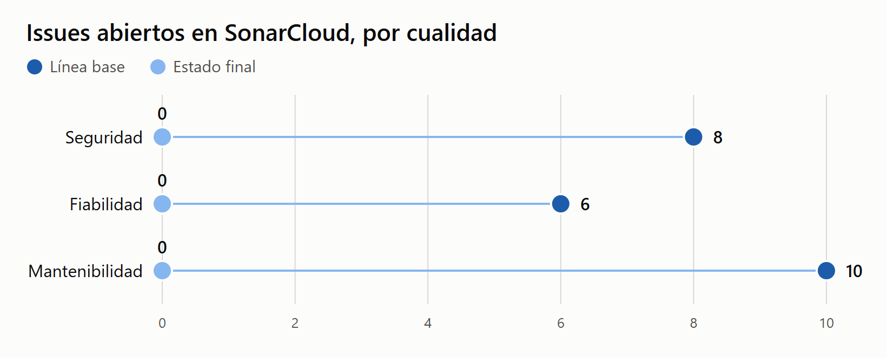
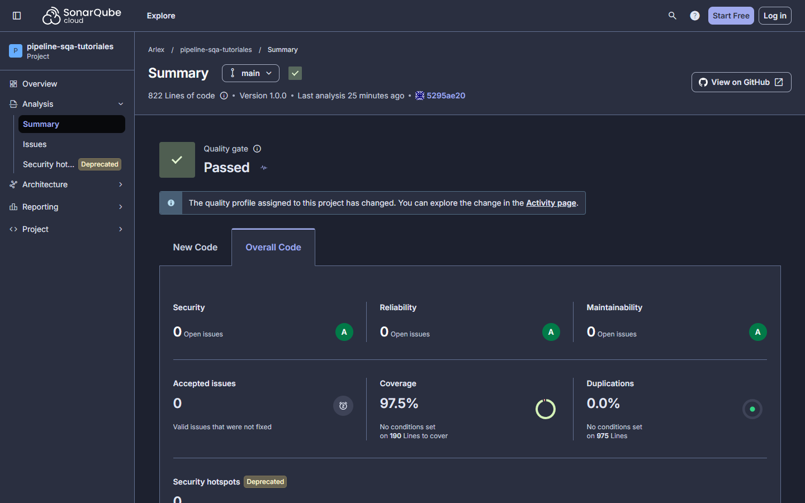
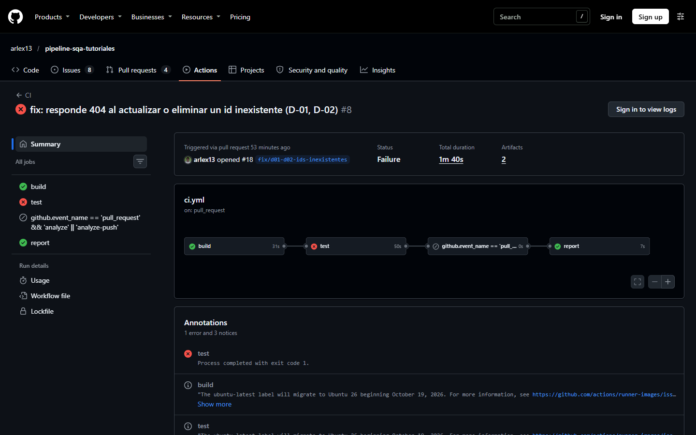
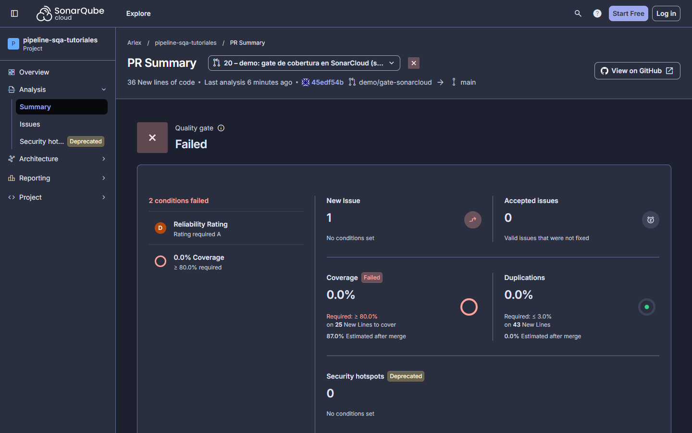
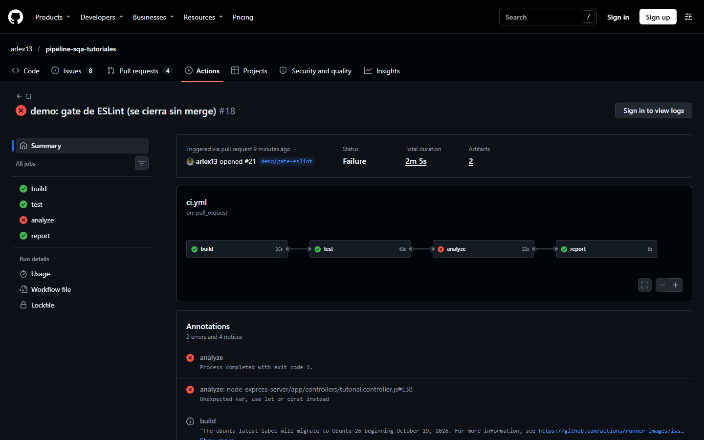
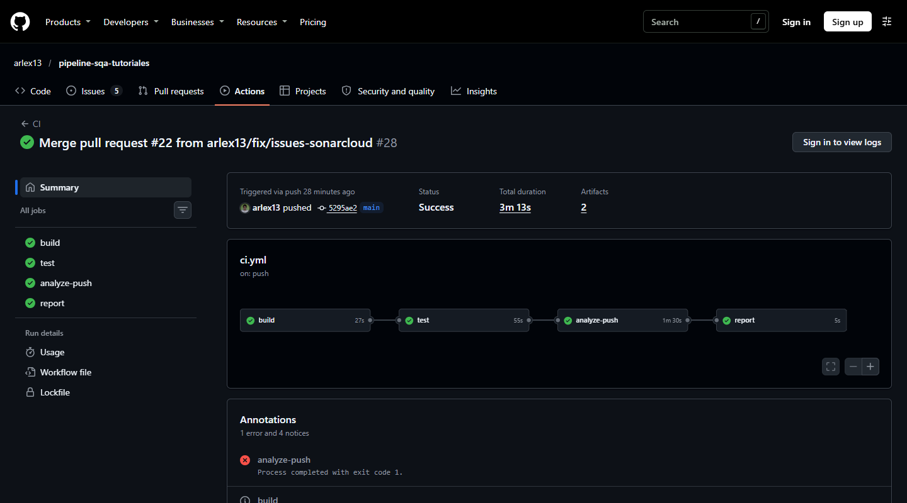

# Reporte de mejora

Comparativa entre el código original y el estado final, medidos con las mismas herramientas y reglas. La línea base y sus comandos están en [Linea-Base-Calidad.md](Linea-Base-Calidad.md). Las cifras de este documento salen de [medicion-final.json](evidencia/final/medicion-final.json), generado por script a partir de cada medición, y de la [corrida final](https://github.com/arlex13/pipeline-sqa-tutoriales/actions/runs/42073629992) del pipeline.

| Dato                           | Línea base                          | Estado final                        |
| ------------------------------ | ----------------------------------- | ----------------------------------- |
| Estado medido                  | `4211d44`, etiqueta `v0-linea-base` | `5295ae2`, etiqueta `v1.0.0`        |
| Fecha de medición              | 5 de noviembre de 2026              | 5 de noviembre de 2026              |
| Versión en SonarCloud          | 0.0.0                               | 1.0.0                               |
| Análisis de SonarCloud         | 08:20 UTC                           | 17:22 UTC                           |
| Perfil de reglas de JavaScript | Sonar way comprehensive, 481 reglas | Sonar way comprehensive, 481 reglas |

## 1. Resumen

| Métrica                              | Línea base                             | Estado final | Cambio |
| ------------------------------------ | -------------------------------------- | ------------ | ------ |
| Pruebas automatizadas                | 0                                      | 48           | +48    |
| Cobertura en SonarCloud              | 0.0 %                                  | 97.5 %       | +97.5  |
| Calificación de seguridad            | C                                      | A            |        |
| Calificación de fiabilidad           | B                                      | A            |        |
| Calificación de mantenibilidad       | A                                      | A            |        |
| Issues de SonarCloud                 | 23                                     | 0            | -23    |
| Hallazgos de ESLint                  | 11                                     | 0            | -11    |
| Archivos sin formato                 | 19 de 24                               | 0 de 47      |        |
| Avisos críticos y altos del servidor | 1                                      | 0            | -1     |
| Avisos críticos y altos del cliente  | 14                                     | 13           | -1     |
| Deuda técnica de mantenibilidad      | 1 h 10 min                             | 0 min        |        |
| Esfuerzo de remediación total        | 4 h 50 min                             | 0 min        |        |
| Duplicación                          | 0.0 %                                  | 0.0 %        | 0      |
| Quality gate de `main`               | Aprobado, sin código nuevo que evaluar | Aprobado     |        |

Los issues por cualidad de la línea base son 8, 6 y 10. Suman 24 y no 23, porque un issue afecta a dos cualidades.

## 2. Pruebas y cobertura

Resultados del JSON de Jest de la [corrida final](https://github.com/arlex13/pipeline-sqa-tutoriales/actions/runs/42073629992). El detalle de cada caso está en [Matriz-Pruebas.md](Matriz-Pruebas.md).

| Paquete  | Pruebas | Aprobadas | Fallidas | Líneas  | Sentencias | Funciones | Ramas   |
| -------- | ------- | --------- | -------- | ------- | ---------- | --------- | ------- |
| Servidor | 25      | 25        | 0        | 98.82 % | 98.82 %    | 95.83 %   | 86.66 % |
| Cliente  | 23      | 23        | 0        | 100 %   | 100 %      | 100 %     | 93.75 % |

- **Umbral.** 70 % de líneas, sentencias y funciones, y 60 % de ramas, por paquete. El mínimo del enunciado es 60 %.
- **Por qué 28 casos son 48 pruebas.** La matriz tiene 28 casos, y varios usan `it.each`, así que Jest cuenta una prueba por cada operación.
- **SonarCloud reporta 97.5 %,** con 190 líneas por cubrir. No coincide con ninguna columna de Jest, porque es una métrica que mezcla líneas y condiciones de los dos paquetes juntos. Cada cifra debe leerse con su fuente.
- **Sobre el código nuevo,** que es lo que evalúa el gate, la cobertura es 93.1 %, y Sonar way exige 80 %.

## 3. ESLint y Prettier

| Paquete  | Errores antes | Advertencias antes | Errores ahora | Advertencias ahora |
| -------- | ------------- | ------------------ | ------------- | ------------------ |
| Servidor | 8             | 0                  | 0             | 0                  |
| Cliente  | 0             | 3                  | 0             | 0                  |

Las reglas son las mismas en ambas mediciones: `eslint.config.mjs` en el servidor y `.eslintrc.json` en el cliente. El código no tiene ninguna supresión de ESLint.

Prettier encontraba 19 archivos sin formato de 24. Hoy revisa 47, porque el repositorio creció con pruebas y documentos, y no encuentra ninguno. La salida está en [prettier-check.txt](evidencia/final/prettier-check.txt).

## 4. SonarCloud

| Métrica                                 | Línea base | Estado final | Cambio |
| --------------------------------------- | ---------- | ------------ | ------ |
| Bugs, familia antigua                   | 1          | 0            | -1     |
| Vulnerabilidades, familia antigua       | 8          | 0            | -8     |
| Code smells, familia antigua            | 14         | 0            | -14    |
| Issues de seguridad, familia nueva      | 8          | 0            | -8     |
| Issues de fiabilidad, familia nueva     | 6          | 0            | -6     |
| Issues de mantenibilidad, familia nueva | 10         | 0            | -10    |
| Hotspots de seguridad                   | 0          | 0            | 0      |
| Líneas de código (`ncloc`)              | 778        | 822          | +44    |
| Duplicación                             | 0.0 %      | 0.0 %        | 0      |
| Complejidad ciclomática                 | 103        | 112          | +9     |
| Complejidad cognitiva                   | 20         | 21           | +1     |
| Razón de deuda                          | 0.3 %      | 0.0 %        | -0.3   |

**Por severidad:**

| Escala antigua | Línea base | Estado final | Escala nueva, por impacto | Línea base | Estado final |
| -------------- | ---------- | ------------ | ------------------------- | ---------- | ------------ |
| Blocker        | 0          | 0            | Blocker                   | 0          | 0            |
| Critical       | 5          | 0            | High                      | 0          | 0            |
| Major          | 7          | 0            | Medium                    | 0          | 0            |
| Minor          | 11         | 0            | Low                       | 0          | 0            |
| Info           | 0          | 0            | Info                      | 0          | 0            |

**Equivalencia con la rúbrica.** SonarCloud usa dos escalas, y la rúbrica habla de issues "críticos" y "mayoritarios". Este proyecto trata como críticos a Blocker y High, y como mayoritarios a Medium. La equivalencia no es uno a uno: un mismo issue puede tener varios impactos, y por eso la escala nueva sumaba 0 impactos en 23 issues.

**Bugs y code smells.** El panel actual muestra Security, Reliability y Maintainability. Los nombres del enunciado siguen disponibles por API y en los badges del README. Lo más cercano es fiabilidad para bugs y mantenibilidad para code smells, pero no son la misma medida.

**Por regla:**

| Regla              | Qué detecta                                          | Línea base | Estado final | Se corrigió en                                                    |
| ------------------ | ---------------------------------------------------- | ---------- | ------------ | ----------------------------------------------------------------- |
| `jssecurity:S5145` | Inyección en logs: `console.log` de datos sin sanear | 7          | 0            | [#22](https://github.com/arlex13/pipeline-sqa-tutoriales/pull/22) |
| `javascript:S3504` | Uso de `var`                                         | 5          | 0            | [#17](https://github.com/arlex13/pipeline-sqa-tutoriales/pull/17) |
| `javascript:S6853` | Etiqueta de formulario sin control asociado          | 4          | 0            | [#22](https://github.com/arlex13/pipeline-sqa-tutoriales/pull/22) |
| `javascript:S7726` | Función flecha sin nombre                            | 2          | 0            | [#22](https://github.com/arlex13/pipeline-sqa-tutoriales/pull/22) |
| `text:S8564`       | Falta el lockfile del servidor                       | 1          | 0            | [#17](https://github.com/arlex13/pipeline-sqa-tutoriales/pull/17) |
| `javascript:S6582` | Se puede usar encadenamiento opcional                | 1          | 0            | [#22](https://github.com/arlex13/pipeline-sqa-tutoriales/pull/22) |
| `javascript:S1082` | Clic sin alternativa de teclado                      | 1          | 0            | [#22](https://github.com/arlex13/pipeline-sqa-tutoriales/pull/22) |
| `javascript:S6847` | Evento de mouse en un elemento no interactivo        | 1          | 0            | [#22](https://github.com/arlex13/pipeline-sqa-tutoriales/pull/22) |
| `javascript:S6479` | Índice del arreglo usado como `key` en React         | 1          | 0            | [#22](https://github.com/arlex13/pipeline-sqa-tutoriales/pull/22) |

No quedan issues abiertos en `main`. Todos se corrigieron en el código, y ninguno se marcó como falso positivo.

**Lo que no midió SonarCloud.** No marcó las credenciales de D-05 en la línea base. Ese defecto se encontró leyendo el código.

**Aviso del panel.** La captura muestra "The quality profile assigned to this project has changed". Corresponde a un único evento, del análisis de la línea base, a las 08:20 UTC: el proyecto pasó de Sonar way core a Sonar way comprehensive antes de medir. Después el perfil no cambió, y las reglas por lenguaje son las mismas en las dos mediciones.

## 5. `npm audit`

La base de avisos cambia sola, así que una comparación solo es justa el mismo día. Por eso las dependencias originales se auditaron otra vez junto con la medición final, con el mismo lockfile de la línea base.

| Paquete                                 | Crítico | Alto | Moderado | Bajo | Total | Dependencias |
| --------------------------------------- | ------- | ---- | -------- | ---- | ----- | ------------ |
| Servidor, línea base                    | 1       | 0    | 2        | 0    | 3     | 103          |
| Servidor, línea base repetida           | 1       | 0    | 2        | 0    | 3     | 103          |
| Servidor, estado final                  | 0       | 0    | 21       | 3    | 24    | 501          |
| Servidor, estado final, solo producción | 0       | 0    | 2        | 0    | 2     | 102          |
| Cliente, línea base                     | 0       | 14   | 7        | 16   | 37    | 1517         |
| Cliente, línea base repetida            | 0       | 14   | 7        | 16   | 37    | 1517         |
| Cliente, estado final                   | 0       | 13   | 7        | 16   | 36    | 1517         |

- **La repetición dio lo mismo.** Entre las dos mediciones, la base de avisos no cambió para estas dependencias: 3 en el servidor y 37 en el cliente. La mejora que se ve es del proyecto.
- **Servidor.** El aviso crítico era `mysql2`, corregido en D-13. El total sube porque ahora el paquete tiene herramientas de desarrollo, como ESLint y Jest; por eso se muestra también la cifra de producción. El gate exige que no haya altos ni críticos, y se cumple. Los 2 moderados de producción son `sequelize` y su dependencia `uuid`.
- **Cliente.** La comparación es 37 contra 36, y la única diferencia es el alto de `axios`, corregido en D-16. Quedan 13 altos: todos llegan por `react-scripts`, igual que otros 21 avisos, y son la deuda aceptada D-12. Los 2 que no llegan por ahí son `react-router` y `react-router-dom`, moderados, cuyo arreglo exige cambiar a la versión mayor 7, fuera de alcance. Las moderadas no activan el gate, y el `npm audit` del cliente solo reporta.
- **Vigencia.** Estas cifras valen para la fecha de medición.

Salidas completas en [docs/evidencia/final/](evidencia/final/).

## 6. Tamaño

| Paquete               | Líneas de aplicación antes | Líneas de aplicación ahora | Líneas de prueba ahora | `ncloc` antes | `ncloc` ahora |
| --------------------- | -------------------------- | -------------------------- | ---------------------- | ------------- | ------------- |
| `node-express-server` | 276                        | 284                        | 372                    | 211           | 255           |
| `react-client`        | 747                        | 738                        | 450                    | 567           | 567           |

Las líneas son físicas, de archivos `.js`, sin contar pruebas ni configuración de herramientas ([lineas-de-codigo.json](evidencia/final/lineas-de-codigo.json)). `ncloc` es el conteo de SonarCloud, que incluye los archivos de configuración del servidor y `App.css`.

## 7. Defectos

| Defecto | Issue                                                               | Hallazgo                                                            | Resultado                | Pull request                                                      |
| ------- | ------------------------------------------------------------------- | ------------------------------------------------------------------- | ------------------------ | ----------------------------------------------------------------- |
| D-01    | [#1](https://github.com/arlex13/pipeline-sqa-tutoriales/issues/1)   | `PUT` respondía 200 con un id inexistente                           | Corregido, con regresión | [#18](https://github.com/arlex13/pipeline-sqa-tutoriales/pull/18) |
| D-02    | [#2](https://github.com/arlex13/pipeline-sqa-tutoriales/issues/2)   | `DELETE` respondía 200 con un id inexistente                        | Corregido, con regresión | [#18](https://github.com/arlex13/pipeline-sqa-tutoriales/pull/18) |
| D-03    | [#3](https://github.com/arlex13/pipeline-sqa-tutoriales/issues/3)   | `POST` respondía 200 en vez de 201                                  | Corregido, con regresión | [#19](https://github.com/arlex13/pipeline-sqa-tutoriales/pull/19) |
| D-04    | [#4](https://github.com/arlex13/pipeline-sqa-tutoriales/issues/4)   | `DELETE /api/tutorials` borra todo sin autenticación                | Riesgo aceptado          | -                                                                 |
| D-05    | [#5](https://github.com/arlex13/pipeline-sqa-tutoriales/issues/5)   | Credenciales de la base en el código                                | Corregido                | [#17](https://github.com/arlex13/pipeline-sqa-tutoriales/pull/17) |
| D-06    | [#6](https://github.com/arlex13/pipeline-sqa-tutoriales/issues/6)   | `server.js` no se podía importar para probar                        | Corregido                | [#17](https://github.com/arlex13/pipeline-sqa-tutoriales/pull/17) |
| D-07    | [#7](https://github.com/arlex13/pipeline-sqa-tutoriales/issues/7)   | `operatorsAliases` ya no tenía efecto                               | Corregido                | [#17](https://github.com/arlex13/pipeline-sqa-tutoriales/pull/17) |
| D-08    | [#8](https://github.com/arlex13/pipeline-sqa-tutoriales/issues/8)   | `var`, `==`, parámetros sin usar y errores tragados                 | Corregido                | [#17](https://github.com/arlex13/pipeline-sqa-tutoriales/pull/17) |
| D-09    | [#9](https://github.com/arlex13/pipeline-sqa-tutoriales/issues/9)   | URL de la API escrita en el frontend                                | Corregido                | [#17](https://github.com/arlex13/pipeline-sqa-tutoriales/pull/17) |
| D-10    | [#10](https://github.com/arlex13/pipeline-sqa-tutoriales/issues/10) | `react-client/.env` versionado                                      | Riesgo aceptado          | -                                                                 |
| D-11    | [#11](https://github.com/arlex13/pipeline-sqa-tutoriales/issues/11) | Archivo `turorial.routes.js`                                        | Corregido                | [#17](https://github.com/arlex13/pipeline-sqa-tutoriales/pull/17) |
| D-12    | [#12](https://github.com/arlex13/pipeline-sqa-tutoriales/issues/12) | Create React App con avisos de seguridad                            | Riesgo aceptado          | -                                                                 |
| D-13    | [#13](https://github.com/arlex13/pipeline-sqa-tutoriales/issues/13) | `mysql2` con aviso crítico                                          | Corregido                | [#17](https://github.com/arlex13/pipeline-sqa-tutoriales/pull/17) |
| D-14    | [#14](https://github.com/arlex13/pipeline-sqa-tutoriales/issues/14) | Un id no numérico llega a la base, y `PUT` y `DELETE` responden 500 | Deuda abierta            | -                                                                 |
| D-15    | [#15](https://github.com/arlex13/pipeline-sqa-tutoriales/issues/15) | Al editar, la interfaz no avisa si el backend rechaza el cambio     | Deuda abierta            | -                                                                 |
| D-16    | [#16](https://github.com/arlex13/pipeline-sqa-tutoriales/issues/16) | `axios` con avisos altos                                            | Corregido                | [#17](https://github.com/arlex13/pipeline-sqa-tutoriales/pull/17) |

**Lo que no se corrigió, y por qué:**

| Defecto | Motivo                                                                                          | Riesgo que permanece                                               |
| ------- | ----------------------------------------------------------------------------------------------- | ------------------------------------------------------------------ |
| D-04    | Lo usa el botón Remove All, y la autenticación está fuera de alcance                            | Cualquiera con acceso a la API puede borrar la tabla               |
| D-10    | Solo contiene `PORT=8081`, por convención de Create React App                                   | Ninguno mientras no se agreguen secretos ahí                       |
| D-12    | Migrar de framework amplía el alcance                                                           | 13 avisos altos, sobre todo en herramientas de compilación         |
| D-14    | Impacto bajo: es un error del cliente reportado como error del servidor                         | `PUT` y `DELETE` con un id no numérico responden 500 en vez de 400 |
| D-15    | Con D-01 corregido ya no hay éxito falso. Falta mostrar el error, que es una mejora de interfaz | Si el backend rechaza un cambio, el usuario no ve ningún mensaje   |

## 8. Los gates hacen fallar el pipeline

Cada fila es una corrida real con el merge bloqueado por la protección de `main`. El detalle está en [rechazos.json](evidencia/gates/rechazos.json).

| Gate                       | Pull request                                                      | Corrida                                                                                  | Qué falló                                                  | Por qué                                              |
| -------------------------- | ----------------------------------------------------------------- | ---------------------------------------------------------------------------------------- | ---------------------------------------------------------- | ---------------------------------------------------- |
| Prueba fallida             | [#18](https://github.com/arlex13/pipeline-sqa-tutoriales/pull/18) | [`725f0cf`](https://github.com/arlex13/pipeline-sqa-tutoriales/actions/runs/42038649184) | `test`, paso "Pruebas del backend, con cobertura y umbral" | RG-01 y RG-03 fallan; RG-02 pasa                     |
| Prueba fallida             | [#19](https://github.com/arlex13/pipeline-sqa-tutoriales/pull/19) | [`738e545`](https://github.com/arlex13/pipeline-sqa-tutoriales/actions/runs/42042336830) | `test`, paso "Pruebas del backend, con cobertura y umbral" | RG-04 falla                                          |
| Quality gate de SonarCloud | [#20](https://github.com/arlex13/pipeline-sqa-tutoriales/pull/20) | [`45edf54`](https://github.com/arlex13/pipeline-sqa-tutoriales/actions/runs/42045496952) | `analyze`, paso "Análisis de SonarCloud y quality gate"    | 0.0 % de cobertura y fiabilidad D en el código nuevo |
| ESLint con errores         | [#21](https://github.com/arlex13/pipeline-sqa-tutoriales/pull/21) | [`e545963`](https://github.com/arlex13/pipeline-sqa-tutoriales/actions/runs/42045513199) | `analyze`, paso "ESLint del servidor"                      | `no-var` en el servidor                              |

El [#20](https://github.com/arlex13/pipeline-sqa-tutoriales/pull/20) y el [#21](https://github.com/arlex13/pipeline-sqa-tutoriales/pull/21) son demostraciones que se cerraron sin merge. La de SonarCloud falló por dos condiciones: el módulo de prueba no tiene pruebas, y además trae un `sort()` sin función de comparación. Un push directo a `main` también se rechaza: ver [push-directo.txt](evidencia/proteccion/push-directo.txt).

Corrida en rojo de una regresión, con `test` fallido y `analyze` sin correr:

Quality gate de SonarCloud rechazando el pull request de demostración:

Corrida en rojo por ESLint:

Estado final, con las cuatro etapas en verde:

## 9. Revisión manual

Cada pull request que se fusionó lleva el comentario de revisión del responsable. La plantilla y el SQA Plan piden que la revisión sea antes del merge, y en cuatro de ellos fue después. Se deja escrito tal como ocurrió:

| Pull request                                                      | Merge | Comentario de revisión | Orden             |
| ----------------------------------------------------------------- | ----- | ---------------------- | ----------------- |
| [#17](https://github.com/arlex13/pipeline-sqa-tutoriales/pull/17) | 07:42 | 10:08                  | Después del merge |
| [#18](https://github.com/arlex13/pipeline-sqa-tutoriales/pull/18) | 09:52 | 10:08                  | Después del merge |
| [#19](https://github.com/arlex13/pipeline-sqa-tutoriales/pull/19) | 10:01 | 10:15                  | Después del merge |
| [#22](https://github.com/arlex13/pipeline-sqa-tutoriales/pull/22) | 11:20 | 11:20                  | Antes del merge   |
| [#23](https://github.com/arlex13/pipeline-sqa-tutoriales/pull/23) | 14:29 | 14:31                  | Después del merge |

Las horas son del 5 de noviembre de 2026, en la hora de Guatemala. Los gates automáticos sí corrieron antes de cada merge, porque la protección de `main` no deja fusionar sin ellos. La tabla llega hasta el [#23](https://github.com/arlex13/pipeline-sqa-tutoriales/pull/23); el pull request que la actualizó tiene su revisión en GitHub.

## 10. Cómo leer estas cifras

- **Mismas reglas.** Las reglas de ESLint, Prettier y el archivo `sonar-project.properties` no cambiaron entre las mediciones, y el perfil de JavaScript de SonarCloud tampoco.
- **El código creció.** `ncloc` sube de 778 a 822, porque se agregaron `app.js` y configuración. La mejora es de calidad, no de tamaño.
- **Una mejor calificación no prueba ausencia de defectos.** D-05 no lo detectó SonarCloud, y D-14 y D-15 siguen abiertos con 0 issues en el panel. Se encontraron leyendo el código y probando la aplicación.
- **Las regresiones cuidan lo que corrigen.** RG-01 a RG-04 cubren D-01, D-02 y D-03. El resto de los defectos corregidos son de configuración o de estructura, y los controlan los gates.
